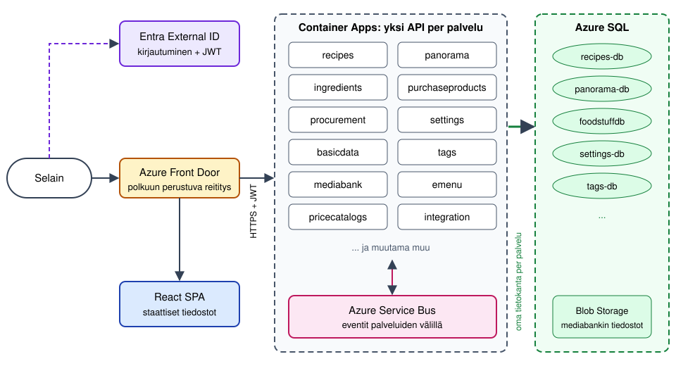
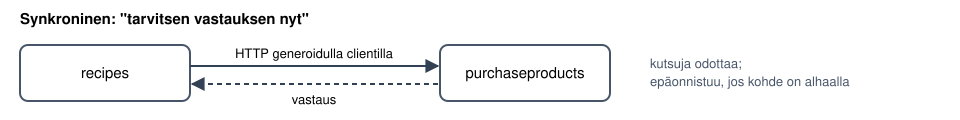
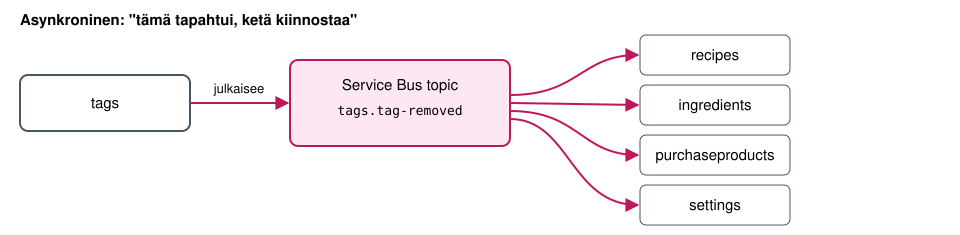
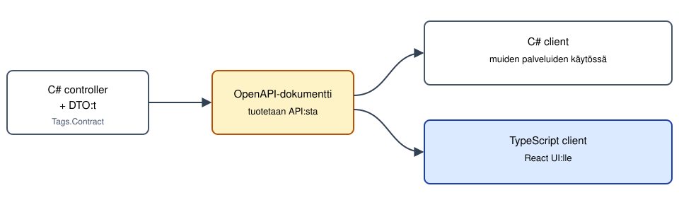

#+TITLE: G6-arkkitehtuuri
#+OPTIONS: toc:nil author:nil timestamp:nil num:nil
#+OPTIONS: reveal_slide_number:nil reveal_fragmentinurl:t reveal_history:t
#+REVEAL_TRANS: fade
#+REVEAL_THEME: serif
#+REVEAL_PLUGINS: (highlight notes)
#+REVEAL_ROOT: https://cdn.jsdelivr.net/npm/reveal.js
#+REVEAL_VERSION: 4
#+REVEAL_HIGHLIGHT_CSS: https://cdnjs.cloudflare.com/ajax/libs/highlight.js/11.11.1/styles/github-dark.min.css
#+OPTIONS: reveal_pdfseparatefragments:nil
#+OPTIONS: reveal_width:1280 reveal_height:800
#+REVEAL_EXTRA_CSS: ./g6-architecture/slides.css

* G6 lyhyesti
:PROPERTIES:
:CUSTOM_ID: glance
:END:
#+ATTR_REVEAL: :frag (appear)
- *Rakenne:* sovellus on jaettu erillisiin palveluihin (microservices), yksi kutakin toiminnallista aluetta kohden, esim. reseptit ja tagit
- *Rajapinta (API):* jokainen palvelu tarjoaa datansa ja toimintonsa rajapinnan kautta
- *Käyttöliittymä:* yksi selaimessa toimiva sovellus (SPA), joka hakee datan palveluilta; React + TypeScript
- *Backend:* C# 14 / .NET 10
- *Data:* Azure SQL, EF Core
- *Multitenant:* yksi instanssi/asennus per alue, ei per asiakas
- *Ajoympäristö:* Azure, infrastruktuuri koodina Bicepillä

* Kokonaiskuva
:PROPERTIES:
:CUSTOM_ID: bigpicture
:END:
#+ATTR_HTML: :width 85%

* Edelleen yksi Git-repositorio
:PROPERTIES:
:CUSTOM_ID: monorepo
:END:
#+ATTR_REVEAL: :frag (appear)
- kaikki palvelut, React-sovellus ja testit ovat samassa repossa
- jokainen palvelu käännetään, testataan ja deployataan erikseen
#+BEGIN_NOTES
Vaikka palveluita on monta, koodi on yhdessä repossa: yhteiset kirjastot ja muutokset useaan palveluun samassa pull requestissa.
Jokaisella palvelulla on silti oma build, testit ja deployment, joten yhden palvelun muutos ei vaadi kaikkien julkaisua.
#+END_NOTES

* Jokainen palvelu omistaa datansa
:PROPERTIES:
:CUSTOM_ID: owndata
:END:
#+ATTR_REVEAL: :frag (appear)
- yksi tietokanta per palvelu: =recipes-db=, =panorama-db=, =tags-db=, ...
- vain omistava palvelu lukee tai kirjoittaa tietokantaansa
- ei SQL-joineja palveluiden välillä
#+BEGIN_NOTES
Tämä on arkkitehtuurin tärkein sääntö.
Kun vain yksi palvelu koskee tietokantaansa, sen skeemaa voi muuttaa rikkomatta muita.
Hinta: tietoa ei voi yhdistää SQL-joinilla palveluiden yli. Seuraavat slidet näyttävät, miten tämä ratkaistaan.
#+END_NOTES

* Palvelut kommunikoivat kahdella tavalla
:PROPERTIES:
:CUSTOM_ID: communication
:END:
#+ATTR_REVEAL: :frag (appear)
#+ATTR_HTML: :width 100%

#+ATTR_HTML: :width 100%
#+ATTR_REVEAL: :frag (appear)

#+BEGIN_NOTES
Synkroninen: kutsuja tarvitsee vastauksen heti ja odottaa. Jos kohdepalvelu on alhaalla, kutsu epäonnistuu.
Asynkroninen: palvelu julkaisee eventin ("tämä tapahtui") Service Bus topiciin, ja kiinnostuneet palvelut käsittelevät sen omaan tahtiinsa.
Lähettäjä ei tiedä eikä välitä, kuka eventin käsittelee.
#+END_NOTES

* Miten recipes näyttää tagin nimen?
:PROPERTIES:
:CUSTOM_ID: nojoins
:END:
#+ATTR_REVEAL: :frag (appear)
- Vaihtoehto 1: kysy tags-API:lta HTTP-kutsulla
- Vaihtoehto 2: pidä paikallinen kopio tarvittavasta datasta, eventit pitävät sen ajan tasalla
  #+ATTR_REVEAL: :frag (appear)
  - recipes, ingredients ja purchaseproducts jne. tallentavat kukin tagista tarvitsemansa tiedot
  - =tags.tag-updated= ja =tags.tag-removed= pitävät kopiot ajan tasalla
#+ATTR_REVEAL: :frag (appear)
Data kopioidaan (denormalisoidaan) tarkoituksella; omistaja pysyy totuuden lähteenä.
#+BEGIN_NOTES
Konkreettinen esimerkki edellisestä.
Vaihtoehto 1 on yksinkertainen, mutta tekee recipesistä riippuvaisen tagsin saatavuudesta ja lisää kutsuja.
Vaihtoehto 2: palvelut pitävät omaa kopiota tarvitsemistaan tagin tiedoista ja päivittävät sen eventtien perusteella.
Kopio voi olla hetken vanhentunut, mutta tags pysyy aina totuuden lähteenä.
#+END_NOTES

* Autentikointi
:PROPERTIES:
:CUSTOM_ID: authn
:END:
#+ATTR_REVEAL: :frag (appear)
- Microsoft Entra External ID (OIDC), joka tukee SSO:ta
- React-sovellus saa EEID:ltä JWT tokenin ja lähettää sen Authorization-headerissa jokaisessa API-kutsussa
- jokainen API validoi tokenin itse EEID:tä vasten
#+BEGIN_NOTES
Kirjautuminen hoidetaan Entra External IDllä; emme toteuta salasanoja tai kirjautumista itse.
Kirjautumaton käyttäjä ohjataan käyttöliittymältä EEID:n kirjautumissivulle, josta käyttäjä saa tokenin.
#+END_NOTES

* Multitenancy
:PROPERTIES:
:CUSTOM_ID: tenancy
:END:
#+ATTR_REVEAL: :frag (appear)
- yksi deployment (asennus) per alue palvelee kaikkia asiakkaita (tenantteja)
- kaikki tenantit jakavat samat tietokannat; tenantille kuuluvilla riveillä on =TenantId=
- JWT token (=Authorization=-header) kertoo, kuka käyttäjä on
- =Tenant-Id=-header kertoo, missä tenantissa hän työskentelee
- API tarkistaa oikeuden tenanttiin, jos ei oikeutta, palautetaan 403 Forbidden
#+BEGIN_NOTES
Yksi käyttäjä voi kuulua useampaan tenanttiin.
#+END_NOTES

* API-kerros
:PROPERTIES:
:CUSTOM_ID: api
:END:
#+ATTR_REVEAL: :frag (appear) :code_attribs data-line-numbers='1-3|5-12|14-20|'
#+BEGIN_SRC csharp
[ApiController]
[Route("api/tags/v1/tags")]
public class TagsController(TagsDbContext dbContext) : ControllerBase
{
    [HttpGet("{id:guid}")] // esim. "6ff15738-0dce-44d4-a16e-a4541e3dba08"
    [EndpointName(nameof(GetTag))]
    [ProducesResponseType(StatusCodes.Status200OK)]
    [ProducesResponseType(StatusCodes.Status404NotFound)]
    public async Task<ActionResult<TagDto>> GetTag(Guid id, CancellationToken ct)
    {
        // Hae ja palauta tagi
    }

    [HttpPost]
    [EndpointName(nameof(CreateTag))]
    [ProducesResponseType(StatusCodes.Status201Created)]
    public async Task<ActionResult<TagDto>> CreateTag(CreateTagDto dto, CancellationToken ct)
    {
        // Luo tagi
    }
}
#+END_SRC
#+BEGIN_NOTES
Kysy onko G5:ssä controllerin käsitettä.
Route määrittää polun, ja tietokanta injektoidaan konstruktorissa.
Seuraavilla slideilla käydään GET ja POST läpi erikseen.
#+END_NOTES

* API-kerros: GET
:PROPERTIES:
:CUSTOM_ID: apiget
:END:
#+ATTR_REVEAL: :code_attribs data-line-numbers='|1|7-8|2-4|5,7|' data-fragment-index='0'
#+BEGIN_SRC csharp
[HttpGet("{id:guid}")] // esim. "6ff15738-0dce-44d4-a16e-a4541e3dba08"
[EndpointName(nameof(GetTag))]
[ProducesResponseType(StatusCodes.Status200OK)]
[ProducesResponseType(StatusCodes.Status404NotFound)]
public async Task<ActionResult<TagDto>> GetTag(Guid id, CancellationToken ct)
{
    var tag = await dbContext.Tags.FirstOrDefaultAsync(t => t.Id == id, ct);
    return tag is null ? NotFound() : tag.ToDto();
}
#+END_SRC
#+ATTR_REVEAL: :frag (appear appear appear) :frag_idx (0 1 2 3)
- =GET /api/tags/v1/tags/{id}=
- 200 Ok ja palautetaan tagi, jos =id=:tä vastaava löytyy, 404 NotFound, jos ei löydy
- =EndpointName= ja =ProducesResponseType= päätyvät OpenAPI-dokumenttiin: clientin metodinimet, dokumentoidut statuskoodit
- =CancellationToken=: työ keskeytyy, jos HTTP-pyyntö perutaan (esim. käyttäjä poistuu sivulta)
#+BEGIN_NOTES
Polussa oleva id on Guid; jos se ei ole Guid, reitti ei täsmää.
EndpointName ja ProducesResponseType eivät vaikuta ajonaikaiseen toimintaan, mutta ne päätyvät OpenAPI-dokumenttiin ja sitä kautta generoituihin clienteihin.
CancellationToken välitetään tietokantakyselyyn asti, joten turhaa työtä ei tehdä loppuun jos esim käyttäjä poistui jo API-kutsun käynnistäneeltä sivulta.
#+END_NOTES

* API-kerros: POST
:PROPERTIES:
:CUSTOM_ID: apipost
:END:
#+ATTR_REVEAL: :code_attribs data-line-numbers='|7,15|3|' data-fragment-index='0'
#+BEGIN_SRC csharp
public record CreateTagDto
{
    public required string Name { get; init; }
    public TagColor Color { get; init; }
}

[HttpPost]
[EndpointName(nameof(CreateTag))]
[ProducesResponseType(StatusCodes.Status201Created)]
public async Task<ActionResult<TagDto>> CreateTag(CreateTagDto dto, CancellationToken ct)
{
    var tag = new Tag { Name = dto.Name, Color = dto.Color };
    dbContext.Tags.Add(tag);
    await dbContext.SaveChangesAsync(ct);
    return CreatedAtAction(nameof(GetTag), new { id = tag.Id }, tag.ToDto());
}
#+END_SRC
#+ATTR_REVEAL: :frag (appear appear appear) :frag_idx (0 1 2)
- =POST /api/tags/v1/tags=
- puuttuva =required=-property DTO:ssa: 400 BadRequest ennen kuin oma koodimme ajetaan
- virheet palautetaan yhdessä standardimuodossa (ProblemDetails), jotta UI voi kohdistaa ne lomakkeen kenttiin
#+BEGIN_NOTES
DTO (Data Transfer Object) kuvaa, mitä API ottaa vastaan; entiteetti pysyy sisäisenä.
required-property validoidaan jo ennen controlleria (middleware): jos Name puuttuu, vastaus on 400 eikä metodia kutsuta.
CreatedAtAction palauttaa 201:n ja Location-headerin, joka osoittaa GET-endpointiin.
ProblemDetails on standardimuoto virheille, joten UI voi näyttää virheet oikeiden kenttien kohdalla.
#+END_NOTES

* Datan käsittely: EF Core
:PROPERTIES:
:CUSTOM_ID: efcore
:END:
#+ATTR_REVEAL: :frag (appear) :code_attribs data-line-numbers='|3|4|5|6,10-14|7|'
#+BEGIN_SRC csharp
public class Tag
{
    public Guid Id { get; init; } // esim. "6ff15738-0dce-44d4-a16e-a4541e3dba08"
    public Guid TenantId { get; init; }
    public required string Name { get; set; } // esim. "Aamupala"
    public TagColor Color { get; set; }
    public List<SubTag> SubTags { get; set; } = [];
}

public enum TagColor
{
    Default,
    Color1,
}
#+END_SRC
#+ATTR_REVEAL: :frag (appear) :code_attribs data-line-numbers='|5|6|7|8|'
#+BEGIN_SRC csharp
public class TagConfiguration : IEntityTypeConfiguration<Tag>
{
    public void Configure(EntityTypeBuilder<Tag> builder)
    {
        builder.Property(x => x.Name).HasMaxLength(100).UseCollation("Finnish_Swedish_CI_AS");
        builder.HasIndex(x => x.Name);
        builder.HasIndex(x => x.TenantId);
        builder.HasMany(x => x.SubTags).WithOne(x => x.Tag).HasForeignKey(x => x.TagId);
    }
}
#+END_SRC
#+BEGIN_NOTES
Entiteetti on tavallinen C#-luokka.
Konfiguraatio määrittää sarakkeiden ominaisuudet: Namen maksimipituuden, collationin (suomalainen aakkosjärjestys, kirjainkoko ei merkitse) ja indeksin.
Konfiguraatiossa määritellään myös indeksit ja relaatiot, esim. tagin alatagit.
#+END_NOTES

* DbContext
:PROPERTIES:
:CUSTOM_ID: dbcontext
:END:
#+ATTR_REVEAL: :code_attribs data-line-numbers='|1|3|7|'
#+BEGIN_SRC csharp
public class TagsDbContext(DbContextOptions<TagsDbContext> options) : DbContext(options)
{
    public DbSet<Tag> Tags => Set<Tag>();

    protected override void OnModelCreating(ModelBuilder modelBuilder)
    {
        modelBuilder.ApplyConfiguration(new TagConfiguration());
    }
}
#+END_SRC
#+ATTR_REVEAL: :frag (appear)
- yksi DbContext per palvelu, osoittaa palvelun omaan tietokantaan
#+BEGIN_NOTES
DbContext on EF Coren pääsy tietokantaan. DbSet vastaa yhtä taulua.
Jokaisella palvelulla on oma tietokanta ja oma DbContext.
Koska DbContext luodaan per pyyntö, se tietää kutsun tenantin.
Oletuksena kyselyt ovat read-only, koska suurin osa kyselyistä vain lukee dataa ja seuranta maksaa.
#+END_NOTES

* Datan haku ja päivitys
:PROPERTIES:
:CUSTOM_ID: efquery
:END:
#+ATTR_REVEAL: :frag (appear)
Haku
#+ATTR_REVEAL: :frag (appear)
#+BEGIN_SRC csharp
var tag = await dbContext.Tags.FirstOrDefaultAsync(t => t.Id == id, ct);
#+END_SRC
#+ATTR_REVEAL: :frag (appear)
Päivitys
#+ATTR_REVEAL: :frag (appear) :code_attribs data-line-numbers='|1-3|2|4|5|'
#+BEGIN_SRC csharp
var tag = await dbContext.Tags
    .AsTracking() // EF seuraa entiteettiä, joten SaveChanges tietää mitä muuttui
    .FirstAsync(t => t.Id == id, ct);
tag.Name = "Lounas";
await dbContext.SaveChangesAsync(ct); // EF kirjoittaa kaikki muutokset yhdessä transaktiossa
#+END_SRC
#+ATTR_REVEAL: :frag (appear)
Päivitys hakematta ensin
#+ATTR_REVEAL: :frag (appear)
#+BEGIN_SRC csharp
await dbContext.Tags
    .Where(t => t.Id == id)
    .ExecuteUpdateAsync(s => s.SetProperty(t => t.Color, newColor), ct); // yksi UPDATE, ajetaan heti
#+END_SRC
#+ATTR_REVEAL: :frag (appear)
Kyselyt ovat C#:ia, ja kääntäjä tarkistaa ne; EF kirjoittaa SQL:n ajonaikaisesti.
#+BEGIN_NOTES
Kysely: LINQ, josta EF tekee SQL:n.
Päivitys: AsTracking, muokataan oliota, SaveChanges kirjoittaa muutokset yhdessä transaktiossa.
Päivitys hakematta ensin: ExecuteUpdateAsync tekee yhden UPDATE-lauseen suoraan kantaan, ilman entiteetin lataamista.
Kaikki kyselyt ovat C#:ia, joten kääntäjä tarkistaa kenttien nimet ja tyypit.
#+END_NOTES

* Multitenancy: EF Core
:PROPERTIES:
:CUSTOM_ID: tenantfilter
:END:
#+ATTR_REVEAL: :frag (appear)
#+BEGIN_SRC csharp
public class Tag
{
    public Guid Id { get; init; }
    public Guid TenantId { get; init; }
    public required string Name { get; set; }
}
#+END_SRC
#+ATTR_REVEAL: :frag (appear)
Globaali query filter lisätään jokaiseen entiteettiin kohdistuvaan kyselyyn:
#+ATTR_REVEAL: :frag (appear) :code_attribs data-line-numbers='|5-7|'
#+BEGIN_SRC csharp
public class TagsDbContext(DbContextOptions<TagsDbContext> options) : DbContext(options)
{
    protected override void OnModelCreating(ModelBuilder modelBuilder)
    {
        modelBuilder
            .Entity<Tag>()
            .HasQueryFilter(e => e.TenantId == "TENANT ID OF CURRENT USER");
        base.OnModelCreating(modelBuilder);
    }
}
#+END_SRC
#+ATTR_REVEAL: :frag (appear)
- =dbContext.Tags.ToListAsync()= palauttaa vain tietyn tenantin tagit
#+BEGIN_NOTES
Tenant-eristystä ei jätetä jokaisen kehittäjän muistettavaksi.
Query filter lisätään DbContextiin kerran, ja EF lisää sen automaattisesti jokaiseen kyselyyn.
Tavallinen ToListAsync palauttaa siis vain nykyisen tenantin rivit.
#+END_NOTES

* EF Coren generoima SQL
:PROPERTIES:
:CUSTOM_ID: efsql
:END:
#+ATTR_REVEAL: :frag (appear) :code_attribs data-line-numbers='|1,5|'
#+BEGIN_SRC sql
DECLARE @ef_filter__TenantId uniqueidentifier = '11111111-1111-1111-1111-111111111111';

SELECT Id, TenantId, Name
FROM Tags
WHERE TenantId = @ef_filter__TenantId
#+END_SRC
#+ATTR_REVEAL: :frag (appear)
- tenantin query filter lisätään =WHERE=-ehtoon ilman, että koodimme pyytää sitä
- arvot ovat parametreja, joten ei SQL-injektiota
#+BEGIN_NOTES
Tältä näyttää EF:n generoima SQL.
TenantId-ehto on mukana, vaikka emme kirjoittaneet sitä kyselyyn.
Arvot välitetään parametreina, mikä suojaa SQL-injektiolta.
#+END_NOTES

* Tietokantamigraatiot
:PROPERTIES:
:CUSTOM_ID: migrations
:END:
#+ATTR_REVEAL: :frag (appear)
- skeema seuraa C#-mallia, mitään ei kirjoiteta käsin
- muuta mallia ja aja =dotnet ef migrations add <MigraationNimi>=
- EF generoi migraatioluokan (=Up= / =Down=), joka commitoidaan muutoksen mukana
- CI (GitHub workflow) paketoi migraatiot suoritettavaksi bundleksi; deployment ajaa sen palvelun tietokantaa vasten
- tietokanta tietää aina, mitkä migraatiot siihen on ajettu
#+BEGIN_NOTES
Skeemaa ei muuteta käsin. Muutetaan C#-mallia ja luodaan migraatio komennolla. (code first)
Migraatio on koodia ja menee katselmointiin muun muutoksen mukana.
CI paketoi migraatiot bundleksi, ja deployment ajaa sen ennen uuden version käynnistämistä.
Tietokannassa on taulu ajetuista migraatioista, joten sama migraatio ei aja kahdesti.
#+END_NOTES

* API-sopimus: OpenAPI
:PROPERTIES:
:CUSTOM_ID: openapi
:END:
#+ATTR_HTML: :width 100%
#+ATTR_REVEAL: :frag (appear)

#+ATTR_REVEAL: :frag (appear)
- clientit generoidaan, niitä ei koskaan kirjoiteta käsin
- ei tarvitse huolehtia kutsuuko toinen API tai UI endpointtia oikeasta polusta
- rikkova API- tai tyyppimuutos saadaan kiinni koodin käännöksessä
#+BEGIN_NOTES
Jokaisesta API:sta tuotetaan OpenAPI-dokumentti, josta generoidaan clientit: TypeScript-client Reactille ja C#-client muille palveluille.
.Contract-projekti sisältää vain DTO:t eli sen, mitä API:n rajapinnassa näkyy.
Kun API muuttuu rikkovasti, generoitu client muuttuu ja kutsujan käännös epäonnistuu.
#+END_NOTES

* Frontend: React
:PROPERTIES:
:CUSTOM_ID: react
:END:
#+ATTR_REVEAL: :frag (appear)
- React ajetaan selaimessa; palvelin tarjoaa vain dataa APIen kautta
- sovellus on staattisia tiedostoja, ei UI-palvelinta
- uudelleenkäytettävät rakennuspalikat: design tokenit, atomit, komponentit
- komponentit kehitetään ja katselmoidaan Storybookissa
#+BEGIN_NOTES
Kaikki käyttöliittymälogiikka ajetaan selaimessa; backend tarjoaa vain dataa.
Koska sovellus on staattisia tiedostoja, sitä ei tarvitse ajaa omalla palvelimella.
Yhteiset design tokenit, atomit ja komponentit pitävät ulkoasun yhtenäisenä; Storybookissa komponentteja voi kehittää ja katselmoida erillään sovelluksesta.
#+END_NOTES

* Generoidun clientin käyttö Reactissa
:PROPERTIES:
:CUSTOM_ID: tsclient
:END:
#+ATTR_REVEAL: :frag (appear)
#+BEGIN_SRC typescript
// getTagOptions on generoitu tags-API:n GetTag-endpointista
const { data } = useQuery({
  ...getTagOptions({ path: { id } }),
});
#+END_SRC
#+ATTR_REVEAL: :frag (appear)
- tyypitetty kysely ja tyypitetty vastaus
- API:n osoite (=baseUrl=) ja Authorization-header määritellään kerran yhdessä paikassa, ei jokaisessa kutsussa
#+ATTR_REVEAL: :frag (appear)
#+BEGIN_SRC typescript
// kerran sovelluksen käynnistyessä
client.setConfig({ baseUrl: 'https://localhost:5001' });

client.interceptors.request.use(async (request) => {
  request.headers.set('Authorization', `Bearer ${await getAccessToken()}`);
  return request;
});
#+END_SRC
#+BEGIN_NOTES
Sama GetTag-endpoint kuin aiemmin, nyt Reactin puolelta.
getTagOptions on generoitu, eikä sitä kirjoiteta käsin. Se toimii suoraan TanStack Queryn useQueryn kanssa.
Polun parametrit ja vastauksen tyyppi tulevat OpenAPI-dokumentista, joten väärä parametri on käännösvirhe.
Clientin asetukset tehdään kerran sovelluksen käynnistyessä: API:n osoite ja Authorization-headeriin lisättävä token. Yksittäinen kutsu ei siis käsittele osoitteita eikä tokeneita.
#+END_NOTES

* Infrastruktuuri koodina: Bicep
:PROPERTIES:
:CUSTOM_ID: bicep
:END:
#+ATTR_REVEAL: :frag (appear)
- kaikki Azure-resurssit kuvataan Bicepillä
- ei klikkailua Azure-portalissa tai omalta koneelta ajettavia skriptejä
- uusi tietokanta, container app, konfiguraatioarvo jne. on pull request
- samat templatet jokaiselle ympäristölle ja alueelle
#+ATTR_REVEAL: :frag (appear)
#+BEGIN_SRC bicep
databases: [
    { dbName: 'g6-recipes' }
    { dbName: 'g6-panorama' }
    { dbName: 'g6-foodstuff', maxSizeGb: 10 }
    ...
]
#+END_SRC
#+BEGIN_NOTES
Azure-resursseja ei luoda portaalissa klikkailemalla.
Kaikki infra on Bicep-tiedostoissa, ja muutokset tehdään pull requestilla.
Samat templatet tuottavat kaikki ympäristöt ja alueet, joten ne pysyvät samanlaisina.
Esimerkki: uusi tietokanta on yksi rivi listaan.
#+END_NOTES

* Julkaisuprosessi
:PROPERTIES:
:CUSTOM_ID: delivery
:END:
#+ATTR_REVEAL: :frag (appear)
- GitHub Actions, yksi deploy-workflow per palvelu
- pull request: testit ja muut tarkistukset ajetaan muutoksen koskemille projekteille
- merge =main=-haaraan: muutoksen koskemat palvelut käännetään ja deployataan dev-ympäristöön
- julkaisut tehdään =release/YYYY.MM.DD=-haaroina; korjaukset cherry-pickataan niihin
- [[https://www.conventionalcommits.org/][conventional commits]]: =fix(recipes): ...=, =feat(tags): ...=
#+BEGIN_NOTES
Pull requestissa ajetaan vain muutoksen koskemien projektien testit, mikä pitää CI:n nopeana.
Merge mainiin deployaa muuttuneet palvelut automaattisesti dev-ympäristöön.
Julkaisuista tehdään päivätty release-haara; korjaukset tehdään mainiin ja cherry-pickataan release-haaraan.
Conventional commits kertovat, mitä palvelua muutos koskee ja onko se korjaus vai uusi ominaisuus.
#+END_NOTES
